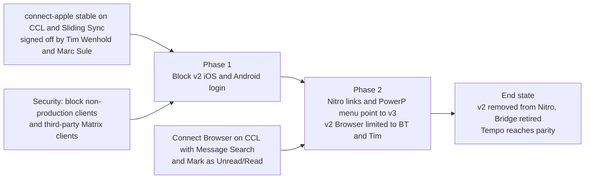

# Projects

Owner: Product and UX. Everything on this page is a **snapshot**: the live
sources are Runway (tickets, epics) and Huddle (design projects). When a project
ships, fold its changes into the [spec](../spec/), [glossary](../glossary/) or
[design](../design/) and remove it here.

| Project | Status | Summary |
|---|---|---|
| Sunset User-Facing Portions of Connect v2 | Active | Remove v2 login for Power employees; point Nitro to v3 |
| Keyboard Shortcuts | Proposed | Ship the proposed rules in [Keyboard](../spec/keyboard/keyboard.md) in five stories: messaging keys, navigation, search, Esc, then palette and slash commands |
| Markdown Support | Shipped; styling refinements proposed | See [Formatting](../spec/messaging/formatting.md) and [Message formatting](../design/message-formatting.md) |

## Sunset User-Facing Portions of Connect v2

Removes every user-facing trace of v2 for Power employees (stories in JEDI,
RBLS, ROGUE). Stream employees already use only v3; many Power employees stay on
v2, mainly because v3 is slow with hundreds or thousands of conversations.

Access is moving to the NitroID "Connect Access" group (JEDI-1087, in testing; a
first attempt deactivated everyone on staging).

## Recent tickets (Sep–Oct 2026)

QA status from QA notes, not a live board check.

| Ticket | Change | QA status |
|---|---|---|
| ROGUE-2675 | 5 most recent 1:1s in New Message (Apple) | Approved, 14977 |
| ROGUE-2736 | OS27 fixes on the CCL client; logo click goes home | Approved, 14690 |
| ROGUE-2749 / -2847 | Siri send-message on CCL; encrypted shared session | Approved, 14947 |
| ROGUE-2751 | Failed-send recovery | Approved, 14914 |
| ROGUE-2781 | Fix appointment and home links on cards | Not tested (14656 crashed) |
| ROGUE-2823 | Crashlytics for CCL Beta, RC, Production | Approved, 14970 |
| ROGUE-2842 | Pause sync on sleep/background (CCL 0.1.17) | Approved, 14892 |
| ROGUE-2848 | Restore Firebase analytics events | Approved |
| ROGUE-2851 | Reset Notification Token toast above macOS User Menu | Approved, 14963 |
| RBLS-3108 | Web drag and drop from websites | Question (Safari Shift-send) |
| RBLS-3215 | Web toasts moved to UniversalToaster | Approved, PR1790 |
| RBLS-3254 | Faster Share Extension typeahead (Android) | Approved, PR1777 |
| RBLS-3255 | Web/PWA notification tap routing | Approved, PR1773 |
| JEDI-1087 | Access from the NitroID Connect Access group | Not tested |

Open defect: clearing a notification on one Apple device sometimes (about 1 in
30) doesn't clear it on the other.

## Design projects in Huddle

As of 2026-10-14. Check here before designing anything new.

| Project | Stage | Status | Handoffs cover |
|---|---|---|---|
| [Error Messaging](https://huddle.powerapp.cloud/projects/506) | Ready for Dev | In progress | Error guide, message send failure, CCL connection and leave-room toasts, update dialogs, macOS crash screen |
| [Impersonation](https://huddle.powerapp.cloud/projects/546) | Ready for Dev | Not started | Per client: Web, Mobile, macOS |
| [Nitro Hashtags](https://huddle.powerapp.cloud/projects/535) | Ready for Dev | Not started | Home Hashtags and Appointment Blocks |
| [User Options](https://huddle.powerapp.cloud/projects/650) | Complete | Finished | User Settings, Notification Preferences, app icon quick actions |
| [Pinning and Saving](https://huddle.powerapp.cloud/projects/561) | Ready for Dev | Not started | Favorite Conversations, Pin Messages, Save Messages (web and Apple) |
| [Keyboard](https://huddle.powerapp.cloud/projects/1047) | Design | In progress | Command Palette, Slash Commands |
| [Nitro Application Portal](https://huddle.powerapp.cloud/projects/788) | Design | In progress | My Personal Device Setup, Connect distribution |
| [Attachments](https://huddle.powerapp.cloud/projects/570) | Ready for Dev | Not started | Upload and download, Share Extension, GIF pause, rich links, drag and drop, multiple attachments, forwarding |
| [Loading](https://huddle.powerapp.cloud/projects/590) | Ready for Dev | In progress | Log-in improvements, syncing toasts, Local Echo, loading conversation history |
| [Unreads](https://huddle.powerapp.cloud/projects/600) | Ready for Dev | Not started | Conversation options, Mark as Unread |
| [Connect 2.0 to 3.0](https://huddle.powerapp.cloud/projects/972) | Upcoming | Not started | v2 to v3 upgrade messaging |
| [Corporate Directory](https://huddle.powerapp.cloud/projects/501) | Complete | Finished | iOS (matches v2), plus a Mac and Web handoff |
| [Message](https://huddle.powerapp.cloud/projects/280) | Ready for Dev | In progress | Self Message, Edit, Delete, Code Styling |
| [Conversation List](https://huddle.powerapp.cloud/projects/495) | Ready for Dev | Finished | Icon Circles, Comfortable, Compact, and Cozy layouts, bot icons, Bookmark to Conversation rename |
| [Room Info & Contact Cards](https://huddle.powerapp.cloud/projects/549) | Ready for Dev | In progress | Conversation Modals, Broadcast Rooms, Archive Rooms, inactive users |
| [Create a Room](https://huddle.powerapp.cloud/projects/628) | Handoff | In progress | Create flow and Audiences |
| [Start a Message](https://huddle.powerapp.cloud/projects/497) | Ready for Dev | In progress | Improved flow with keyboard controls, per-client versions, app icon quick actions |
| [Handoff Repository](https://huddle.powerapp.cloud/projects/489) | Complete | In progress | Quick links to final handoffs; Notification Routing Rules |
| [Audiences 3.0](https://huddle.powerapp.cloud/projects/854) | Ready for Dev | Not started | Updated Audience component |
| [Components](https://huddle.powerapp.cloud/projects/507) | Ready for Dev | Finished | Reaction Bar, macOS top bar, Message Guide, Terminology Guide, New Message Indicators, Date Separator |
| [Basic Search](https://huddle.powerapp.cloud/projects/492) | Ready for Dev | Finished | In-conversation search (v2 parity) per client; global search out of scope |
| [Message Composer](https://huddle.powerapp.cloud/projects/511) | Ready for Dev | Finished | Composer per client, @mention typeahead |
| [Browse Rooms](https://huddle.powerapp.cloud/projects/517) | Ready for Dev | Finished | Desktop and mobile |
| [GIF Picker](https://huddle.powerapp.cloud/projects/528) | Complete | Finished | Web, PWA, macOS, iOS |
| [Reactions](https://huddle.powerapp.cloud/projects/490) | Complete | Finished | Show who reacted |
| [Headers](https://huddle.powerapp.cloud/projects/518) | Complete | Finished | Room and conversation headers |
| [Responsive Breakpoints](https://huddle.powerapp.cloud/projects/555) | Complete | Finished | Breakpoints across devices |
| [Events](https://huddle.powerapp.cloud/projects/601) | Ready for Dev | Not started | Corporate events matching v2 |
| [Supporting Docs for BT Release](https://huddle.powerapp.cloud/projects/591) | Complete | Finished | v3 enhancements and new features |
| [Open App](https://huddle.powerapp.cloud/projects/646) | Handoff | Finished | Use App prompt |
| [User Status](https://huddle.powerapp.cloud/projects/552) | Ready for Dev | Not started | Phase 1 per client |

## Template for a new project entry

Goal · Status and dates · Scope (in and out) · Depends on · Changes to Connect
(as draft rules in the spec, approved when shipped) · Flows (link or summarize
new user flows) · Links (Brief, Runway epic, Figma, Huddle).
