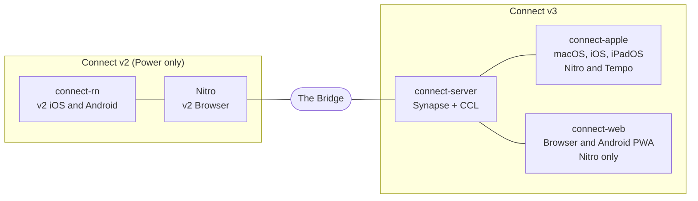

# What Connect is

Owner: Engineering, with UX. The **Status** column is a snapshot (last reviewed
2026-10-28); the live source is each team's Runway board.

Power's internal messaging tool for all employees of Power Home Remodeling and
Stream Innovations. It runs as two systems: **v2**, built into Nitro (green
"Connect" app icon), and **v3**, built on Matrix and served by connect-server
(blue "Nitro Connect" icon). The Bridge keeps them in sync, so most employees
don't know there are two. v3 keeps working when Nitro is down. Terms are defined
in [Systems](../glossary/systems.md).

| Codebase | Clients | Built on | Tenants | Runway / Test IDs | Status |
|---|---|---|---|---|---|
| Nitro (v2) | v2 Browser | Nitro | Power | — | Fully accessible; many people use only this |
| connect-rn (v2) | v2 iOS, v2 Android | React Native | Power | — | Harder to reach; sunset in Phase 1 |
| connect-apple | Connect macOS, Connect iOS (iPhone, iPad) | Matrix Objective-C SDK, moving to CCL | Nitro, Tempo | ROGUE ("Rogue") / CA- | Rolled out from Aug 2025; CCL client in beta |
| connect-web | Connect Browser, Connect PWA (Android) | Matrix JS SDK; CCL next | Nitro | RBLS ("Rebels") / CW- | PWA Jul 2026; Browser targeted late 2026 |
| connect-server | Server, Bridge, CCL | Synapse (Matrix) | Nitro, Tempo | JEDI ("Jedi") / CS- | Live |

Each codebase proves the spec's rules for its own `Needs` targets: connect-apple
for `macos`, `ios` and `ccl`; connect-web for `browser` and `pwa`; connect-server
for `server`; Nitro for `nitro`. See [For engineers](../docs/for-engineers.md).

## Getting Connect

Power-owned Apple devices get Nitro Connect preinstalled or from Self-Service;
personal devices install it from My Personal Device Setup in Nitro.

## Server and Bridge settings

The server has three Bridge toggles: Connect Bridge (rooms), Bridge People
Conversations, Bridge User Preregistration. Don't turn them off without the
server team. What the Bridge carries is specified in
[v2 to v3](../spec/bridge/v2-to-v3.md) and [v3 to v2](../spec/bridge/v3-to-v2.md).
